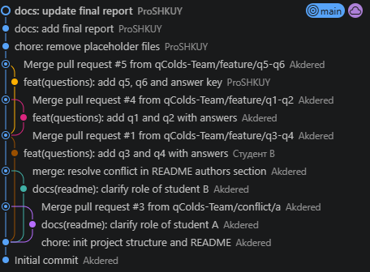
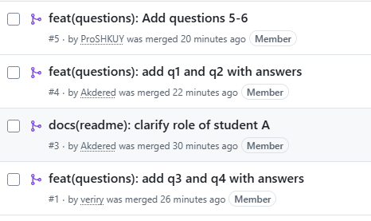
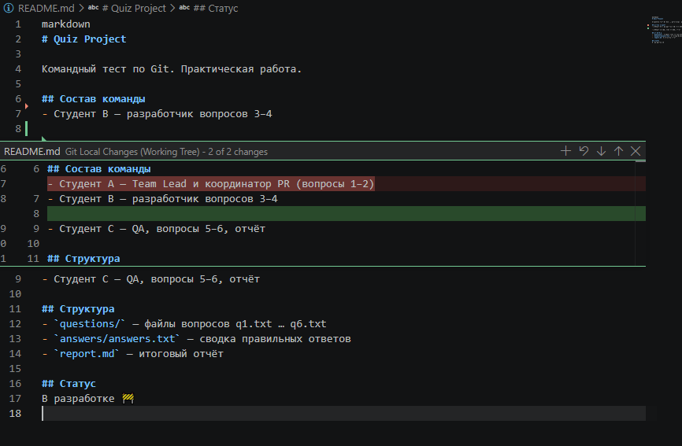
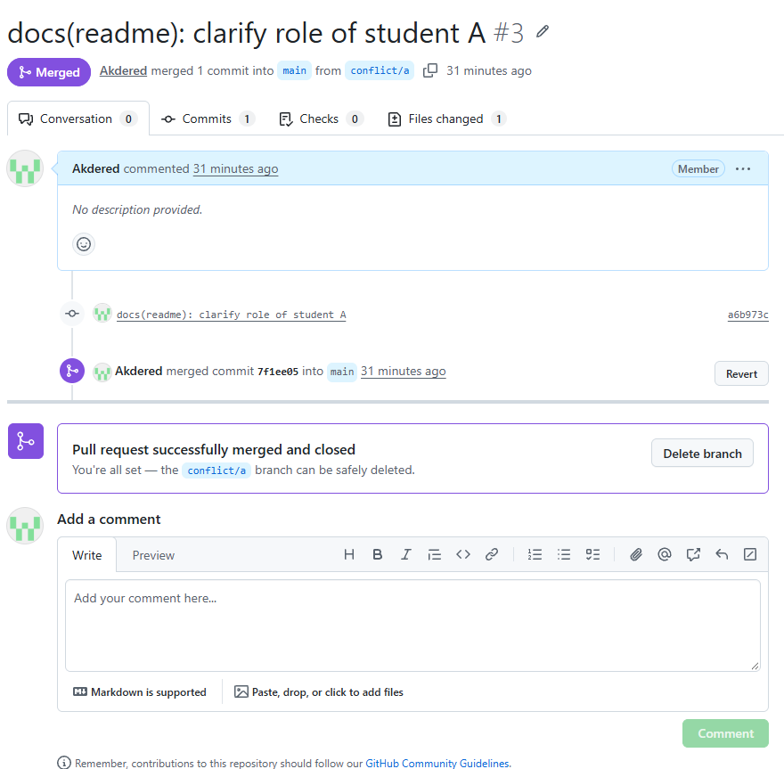

# Отчёт по практической работе «Создание теста командой из четырёх студентов в Git»

## 1. Тема и цель
- Тема: Создание теста командой разработчиков   
- Цель: Научиться использовать основные команды Git для командной работы

## 2. Состав команды
| Роль | ФИО | GitHub |
|------|-----|--------|
| Team Lead (А) | Александр Дерюшев | @Akdered |
| Разработчик 1 (B) | Иван Боронников | @Myssingg |
| Разработчик 2 (B) | Дмитрий Перминов | @veriry |
| Тестировщик (C) | Алексей Колчин | @ProSHKUY |

## 3. Ссылка на репозиторий
https://github.com/qColds-Team/quiz-project

## 4. Распределение задач
- A: вопросы 1–2, README, PR-координация
- B1: вопрос 3, участие в конфликте
- B2: вопрос 4
- C: вопросы 5–6, answers.txt, отчёт

## 5. Хронология работы
1. Создан репозиторий 11.10.2026
2. Ветки feature/* — 11.10.2026
3. PR и merge — 12.10.2026
4. Конфликт и его разрешение — 23.10.2026
5. Финальная проверка — 23.10.2026

## 6. Использованные команды Git
| Команда | Назначение |
|---------|-----------|
| git clone | Клонирует папку репозитория в место, открытое в терминале, создавая при этом одноименую папку|
| git checkout -b | Содание/смена локальной ветки |
| git push | Отправка ветки с коммитом |
| git commit -m "" | Создание коммита |
| git pull | Получение последней версии ветки |
| git add файл | Добаление файла для его последующей отправки с коммитом | 

## 7. Скриншоты
1. Граф коммитов (`git log --graph`)

2. Список Pull Requests

3. Момент конфликта (маркеры в README)

4. Успешный merge

## 8. Возникшие трудности и их решение
- Несвязность работ
- Неполное выполнение заданий, долгая синхронизация между участниками
- Временные трудности с Git

## 9. Выводы
- Мы научились работать с Git
- Теперь мы знаем больше о Git и конфликтах
- Также, наше познание в области командной разработки увеличилось